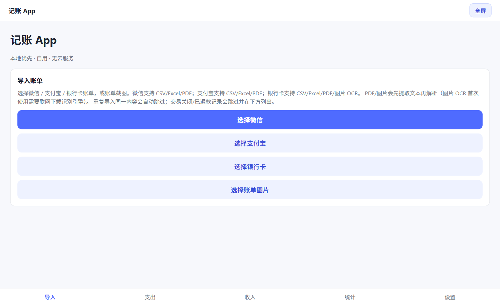
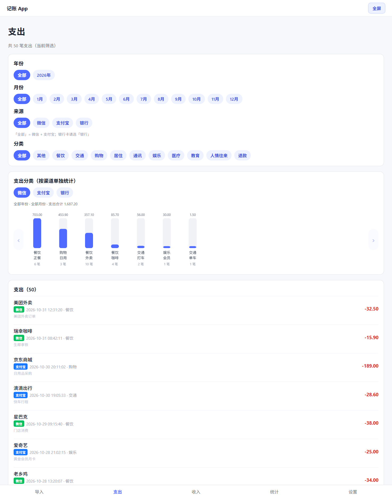
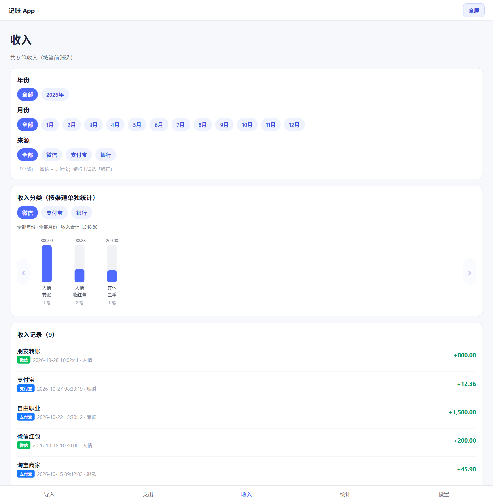
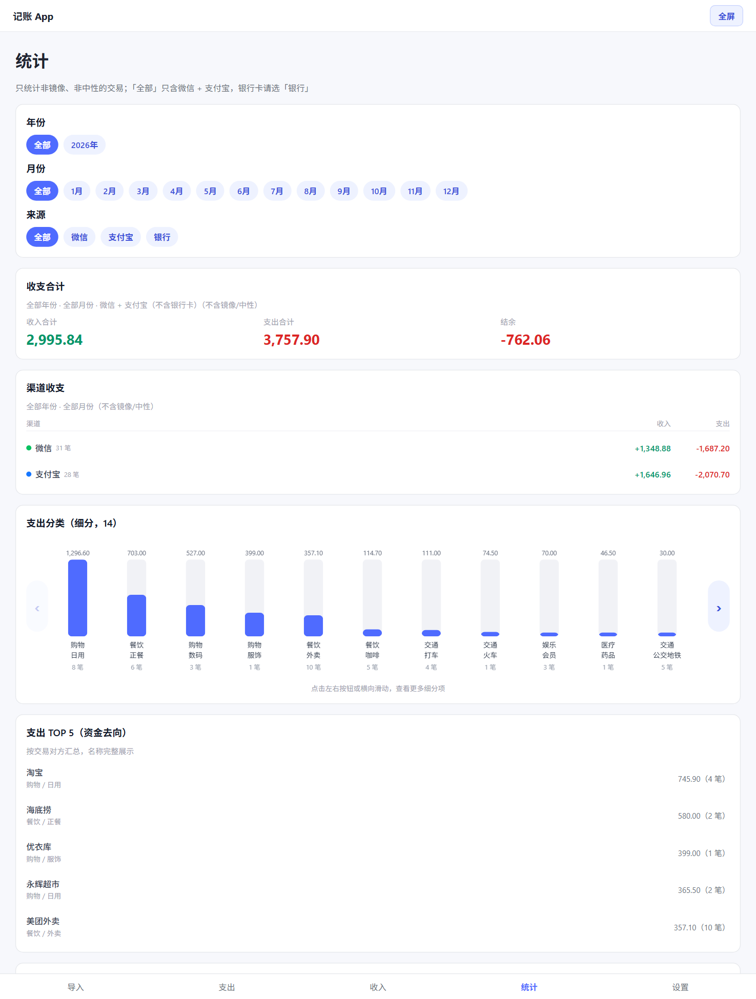
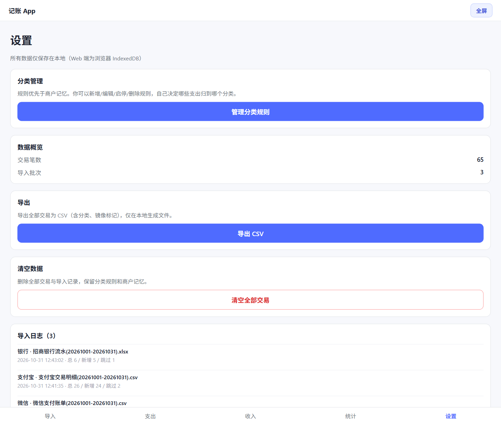

# 记账 App｜本地优先的个人记账工具

把微信、支付宝、银行卡三端的账单导入同一份账本：**自动去重**（同一笔消费同时出现在微信和银行流水时只算一次）、**按规则分类**、按年 / 月 / 渠道 / 分类统计，所有数据只留在本机。

不登录、不联网同步、不上传、不接任何第三方服务——账单是最敏感的一类个人数据，这个项目把"本地优先"当成硬约束，而不是可选项。

`Expo SDK 58` · `React Native` · `TypeScript strict` · `SQLite`


## 界面预览

> 截图使用内置的脱敏演示数据（真实账单不入库）。

| 导入 | 支出 | 收入 |
| --- | --- | --- |
|  |  |  |

| 统计 | 设置 |
| --- | --- |
|  |  |

## 项目背景与目标

个人记账的真实痛点不在于"记账界面不好看"，而在于三件事：

1. **账单分散在三个地方**：微信、支付宝各有一份，银行卡里还有一份，同一笔消费会在两个来源各出现一次。
2. **导出格式不统一**：平台给的是 CSV，银行给的是 Excel 或 PDF，编码、表头、日期格式、金额正负号各不相同，甚至同一家平台不同月份的导出格式都会变。
3. **数据敏感**：把全部消费流水上传到某个云端记账 App，是很多人不愿意做的事。

于是这个项目把目标定得很窄也很清楚：**导入即用、跨端去重、规则归类、纯本地**。它既是一个自用的工具，也是一份用来展示工程能力的求职作品集项目——重点在"脏数据解析、领域建模、本地持久化、可测试性"，而不在 UI 特效。

## 核心功能

### 多来源账单导入

| 来源 | CSV | Excel（.xlsx / .xls） | PDF | 图片 OCR |
| --- | --- | --- | --- | --- |
| 微信支付 | ✅ | ✅ | ✅ | — |
| 支付宝 | ✅ | ✅ | ✅ | — |
| 银行卡 | ✅ | ✅ | ✅ | ✅ |

- 微信：UTF-8 CSV / 多工作表 Excel / PDF 文本，支持"记账本"表头与退款行归类。
- 支付宝：GBK 与 UTF-8 自动识别、跳过文件前 24 行元数据、兼容 `.xls` 实际是 HTML 表格的兜底解析。
- 银行：三种金额表达（收支分列、单列 + 借贷标志、单列带符号）都能识别；PDF 用 pdfjs 按坐标聚合文本行；账单截图用 tesseract.js（`chi_sim+eng`）OCR。
- Excel 会自动挑选含表头的工作表，并在前 40 行内定位表头，跳过导出说明行。

细节见 [docs/import-formats.md](docs/import-formats.md)。

### 跨平台去重

三层判定，越靠前越确定：

1. **同一文件**：内容哈希（归一化 BOM / 换行后）重复 → 整批跳过。
2. **同源重复**：`source_trade_no` 或行哈希已存在 → 跳过；同源不做金额去重，避免误杀"同日同额的两次真实消费"。
3. **跨平台重复**：金额（分）+ 方向 + 交易时间相差 ≤ 1 天 + 商户名相似度 ≥ 0.6 → 后导入的一方标记为「资金来源镜像」（`is_mirror=1`），展示但不计入统计。

商户相似度用字符 bigram 的 Jaccard 系数，并对方一方包含另一方的情况（「美团外卖」 vs「美团外卖有限公司」）给 0.8 的相似度。细节见 [docs/dedup-and-rules.md](docs/dedup-and-rules.md)。

### 分类引擎

- 23 条默认规则（keyword / regex），按 `priority` 升序匹配，命中即停。
- 规则未命中时查「商户记忆」：手动改过一次分类的商户，下次自动沿用。
- 仍未命中显示「其他」，可在支出 / 收入行内直接改分类。
- 规则可在「设置 → 分类管理」里新增、编辑、启停、删除，或一键恢复默认。

### 统计与筛选

- 年 / 月（固定 1–12 月）/ 来源 / 分类多维筛选，筛选条件互相联动。
- 收入合计、支出合计、结余；按渠道（微信 / 支付宝 / 银行）拆分收支。
- 支出按分类 + 子分类的柱形图，可左右滑动查看更多细分项；点击柱子直接筛选下方明细。
- 支出 TOP 5 按交易对方汇总（资金去向），不过滤、不截断名称。
- 镜像记录与中性记录（自己名下账户互转）不计入统计。

### 本地持久化与导出

- Web：SQLite WASM（sql.js），整库序列化写入浏览器 IndexedDB，刷新不丢数据。
- iOS / Android：expo-sqlite，写入本地 `ledger.db`。
- 一键导出全部交易为 CSV（含分类与镜像标记），也可清空数据（二次确认，保留分类规则与商户记忆）。

## 技术栈

| 层 | 技术 | 说明 |
| --- | --- | --- |
| UI | Expo SDK 58、React Native、react-native-web | 一套 TSX 同时跑 Web 与移动端 |
| 语言 | TypeScript（`strict: true`） | 领域层不依赖任何 Expo API |
| 存储 | SQLite：Web 用 sql.js，移动端用 expo-sqlite | 同一套 SQL 与仓储接口，两套适配器 |
| 解析 | pdfjs-dist、xlsx（SheetJS）、read-excel-file、tesseract.js | PDF 文本 / Excel / 图片 OCR |
| 测试 | Vitest（130 个用例 + 脱敏 fixtures） | 领域层纯函数，Node 环境直接跑 |
| 质量 | ESLint（eslint-config-expo）、tsc --noEmit | 提交前 typecheck + lint + test |

### 选型理由

- **Expo + react-native-web**：记账工具的真实使用场景是"电脑上偶尔整理一次"，Web 端比装 App 更合适；同时保留移动端能力，不需要维护两套 UI。
- **SQLite 而不是 JSON / AsyncStorage**：账单是结构化、需要聚合查询的数据，统计页要做按月分组、按分类求和、跨表去重查询——这些交给 SQL 比在 JS 里手写 reduce 更可靠。
- **领域层与框架解耦**：解析、去重、分类、统计全部是不依赖 RN/Expo 的纯函数，所以能在 Node 里用 Vitest 直接测（这也是 130 个用例 2 秒跑完的原因）。
- **金额用整数分**：`amount_cents: INTEGER`，从解析到统计全程不出现浮点数，避免 `0.1 + 0.2` 这类经典问题。
- **不引入状态管理库**：5 个 Tab、本地 SQLite 作为唯一数据源，页面状态就地管理即可，Redux / Zustand 在这个规模下是负债。
- **不接云、不接 AI**：MVP 明确把"隐私"放在"智能"前面；分类靠可解释的规则引擎 + 用户纠正，而不是黑盒模型。

## 系统架构

```text
┌──────────────────────────────────────────────────────────┐
│ UI 层  src/app/                                          │
│   AppTabs（导入 / 支出 / 收入 / 统计 / 设置）             │
│   screens/*  components/CategoryBreakdownChart           │
│   ocr-text / pdf-text / xls-reader / xlsx-reader / pick-csv │
└───────────────────────────┬──────────────────────────────┘
                            │ 只调用仓储接口与纯函数
┌───────────────────────────▼──────────────────────────────┐
│ 数据层  src/data/                                        │
│   repository.ts  交易 / 导入批次 / 商户记忆 / 分类规则     │
│   db/schema.ts   DDL + 迁移（加列兼容旧库）               │
│   db/sqljs.ts    Web：SQLite WASM ⇄ IndexedDB             │
│   db/native.ts   iOS/Android：expo-sqlite                 │
└───────────────────────────┬──────────────────────────────┘
                            │
┌───────────────────────────▼──────────────────────────────┐
│ 领域层  src/domain/（纯函数，Vitest 覆盖）                │
│   parsers/  wechat · alipay · bank · bank-text · columns  │
│   import.ts  解析 → 哈希查重 → 逐条去重 → 分类 → 写库     │
│   dedup.ts · classify.ts · merchant.ts · rules/           │
│   stats.ts · breakdown.ts · money.ts · date.ts · csv.ts   │
└──────────────────────────────────────────────────────────┘
```

## 一次账单导入发生了什么

1. 用户在「导入」页选择文件，按来源（微信 / 支付宝 / 银行卡）走不同的解析入口。
2. Excel 走 SheetJS 读出全部工作表，挑出含账单表头的那一张；PDF 用 pdfjs 提取文本；图片用 tesseract.js OCR 后再交给文本解析器。
3. 解析器按表头名匹配列（兼容"交易时间 / 日期""商户 / 交易对方""收/支 / 类型"等变体），逐行产出标准化的记录：金额转整数分、日期统一 `YYYY-MM-DD HH:mm:ss`、交易关闭 / 失败的记录跳过并写入导入日志。
4. 计算文件哈希（归一化 BOM 与换行），命中已成功导入的批次 → 整批跳过；若上次导入 0 行，则清理失败批次允许重试。
5. 逐条查重：同源订单号 / 行哈希 → 跨平台模糊匹配（金额 + 方向 + ±1 天 + 商户相似度）→ 命中则标记镜像或把旧记录改标记。
6. 对未分类记录执行规则引擎，写入 `transactions`，同时记录 `import_batches`（总行数 / 新增 / 跳过 / 错误摘要），界面展示最终结果。

## 关键难点与解决方案

**1. 账单格式不稳定，且每家都不一样**

真实导出的账单没有 schema：表头可能在第 8 行，可能有多余的合计行，Excel 可能只有部分月份在第二张工作表，`.xls` 其实是 HTML 表格。做法是把"找表头 / 挑工作表 / 猜编码 / 判断金额方向"这些不确定性全部收到解析器层，向上只输出统一的结构化记录；解析器内部用"列名候选集 + 位置兜底"两级匹配，识别失败时把行号和原因返回给 UI，而不是静默丢数据。

**2. 同一笔消费在多个来源重复出现**

只按订单号去重不够（微信、银行各有自己的单号），只按金额去重又会误杀同日同额的真实多笔消费。最终采用分层策略：先按强标识（订单号 / 行哈希）去重；再做跨平台模糊匹配，用"金额 + 方向 + 时间窗 ±1 天 + 商户相似度"四要素共同判定，且**同源永远不做金额去重**。命中后不删除记录，而是标记 `is_mirror`——保留证据链，统计时排除，用户仍能看到"这笔钱来自哪张银行卡"。

**3. 商户名在三个来源里写法不同**

「美团外卖」「美团外卖有限公司」「财付通-美团外卖」在人类看来是同一家，字符串相等判断完全失效。用字符 bigram 的 Jaccard 相似度 + 包含关系的加成，阈值取 0.6；同时把中文标点、全半角、空格统一规范化，避免「（」和「(」造成误判。

**4. 本地优先，但 Web 和移动端的存储机制完全不同**

抽象出 `AppDatabase` 接口（`exec / run / all / close`），Web 实现是 sql.js + IndexedDB，移动端实现是 expo-sqlite。上层的仓储与领域逻辑对平台无感知；Web 端写入用 300ms 去抖序列化，避免每插一行就整库导出。

**5. 账务计算不能有浮点误差**

从解析开始就转整数分，`Math.round(元 × 100)`，此后所有比较、求和、镜像判定都用整数；只有展示时才除以 100 并格式化。

**6. 规则引擎要可解释、可纠正**

规则按 `priority` 命中即停，正则写错不影响其他规则（`try/catch` 后继续）；用户手动改分类会写进商户记忆表，下次同类商户自动命中——把"用户纠正"沉淀成数据，而不是做成一次性操作。

## 代码结构

```text
ledger-app/
├── App.tsx / index.ts              # Expo 入口
├── src/
│   ├── app/                        # 页面、Tab、导入/导出、PDF/OCR/Excel 适配
│   │   ├── screens/                # 导入 / 支出 / 收入 / 统计 / 设置 / 规则管理
│   │   └── components/             # 分类柱形图
│   ├── data/                       # SQLite 仓储、schema 迁移、双平台适配器
│   ├── domain/                     # 纯函数：解析器、去重、分类、统计、金额、日期
│   └── types/                      # 第三方库类型声明
├── tests/                          # 130 个 Vitest 用例 + 脱敏 fixtures
├── scripts/                        # 静态服务器、桌面启动器、fixture 生成
├── docs/                           # 解析细节、去重算法、界面截图
├── public/                         # sql-wasm.wasm、pdf.worker.min.mjs
└── assets/                         # 图标与启动图
```

规模：`src/` 48 个文件、约 4.9k 行 TypeScript；`tests/` 32 个文件、约 2k 行。

## 快速开始

前置：Node.js 22 以上、npm。

```bash
git clone https://github.com/9898998hcx/ledger-app.git
cd ledger-app
npm ci
npm run web          # 打开 http://localhost:8081
```

导入演示数据：仓库里的 `tests/fixtures/*.csv|xlsx|pdf` 是脱敏样例，可以直接在「导入」页选择对应来源的文件试跑。

移动端（可选）：

```bash
npx expo start                  # Expo Go 扫码（跑在 Expo 自带的原生模块上）
npx expo run:android            # 需要 expo-sqlite 的开发构建
npx expo run:ios
```

### Windows 桌面快捷方式（可选）

想在桌面双击直接用，可以构建静态版本并启动本地服务：

```powershell
npm run export:web    # 构建到 dist/
npm run serve:web     # 本地静态服务器，默认 4599 端口
```

`scripts/launch.ps1` + `scripts/launch.vbs` 做了进一步的包装：关闭旧窗口 → 起服务 → 用独立 Edge 配置目录打开应用窗口（数据保存在该配置的 IndexedDB 里，不影响日常浏览器）。脚本全部按自身所在目录解析路径，放到任意目录都能用。

### 质量检查

```bash
npm run typecheck    # tsc --noEmit
npm run lint         # eslint（eslint-config-expo）
npm test             # vitest run：130 个用例
```

## 数据与隐私

- 没有后端、没有账号体系、没有埋点；应用运行期间不发起任何业务网络请求。
- Web 端数据在浏览器 IndexedDB（数据库名 `ledger-app`），移动端在本地 `ledger.db`；删除浏览器数据或清空 App 数据即彻底删除。
- 唯一需要联网的是 OCR：tesseract.js 首次使用要从 CDN 下载识别引擎与中文语言包，之后走浏览器缓存。
- 仓库只包含脱敏 fixtures；`.gitignore` 已排除 `*.db`、`imports/`、`exports/`、`*.local.json` 和本地浏览器配置目录。

## 项目边界与取舍

明确"不做"的事，比"能做"更能说明设计意图：

- **不做云端同步 / 多账本 / 预算提醒**：目标是单人单账本的自用工具，加这些会把"本地优先"的边界打穿。
- **不做手动记账**：真实流水来自平台导出，手记一笔的成本远高于事后导入；当前只提供"导入 + 修正分类"。
- **不接大模型做分类**：分类结果必须可解释、可复现，规则引擎 + 商户记忆已经够用。
- **移动端暂不支持 PDF / OCR / Excel 解析**：重解析留在 Web 端，移动端可以导出 CSV 后导入。这是有意的取舍，不是遗漏。

## Roadmap

- [ ] 移动端补齐 PDF / Excel 解析（pdfjs 在 RN 下需要原生 shim）
- [ ] 多币种（金额表增加 currency 字段 + 汇率快照）
- [ ] 年度报表导出（PDF）
- [ ] 规则命中统计，帮助发现"从未命中"的冗余规则
- [ ] E2E 测试（Playwright 覆盖导入 → 分类 → 统计主链路）

## License

MIT，见 [LICENSE](LICENSE)。
